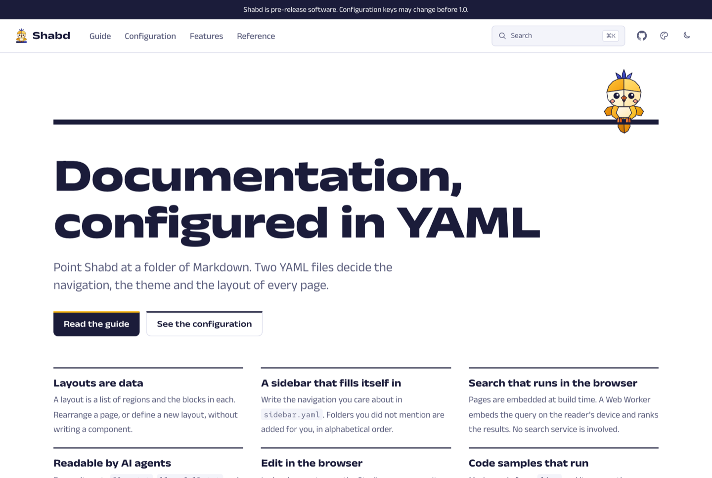
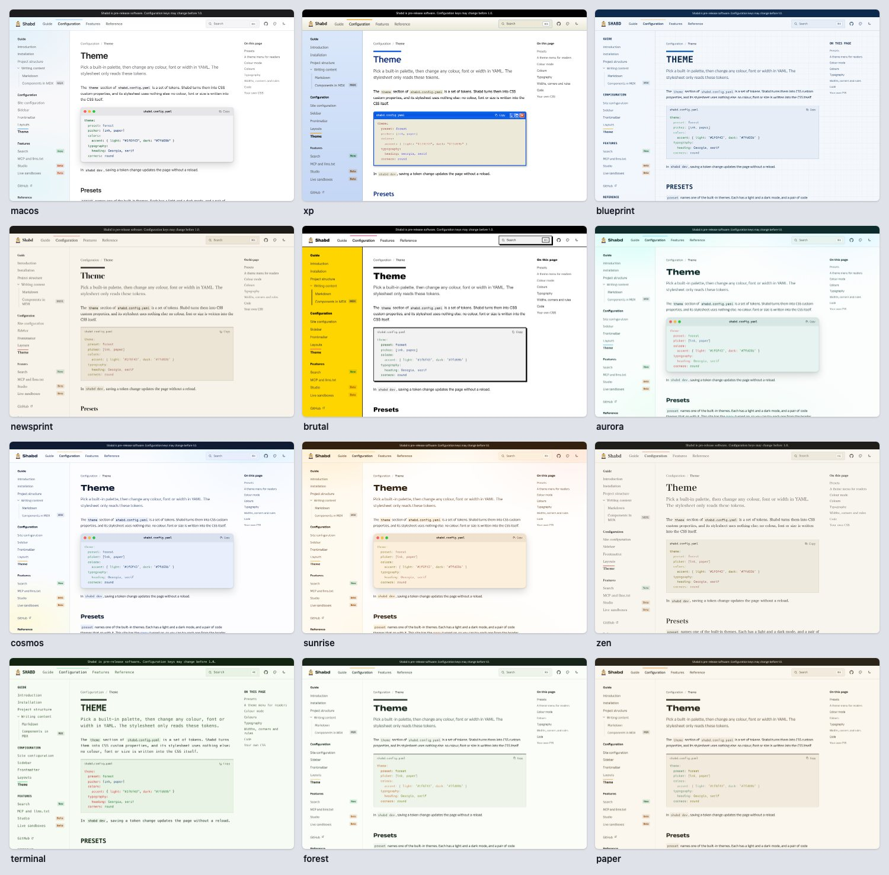

<p align="center">
  <picture>
    <source media="(prefers-color-scheme: dark)" srcset="img/shabd-logo-dark.svg"/>
    
  </picture>
</p>

<p align="center">
<strong>Documentation sites configured in YAML.</strong>
</p>

<p align="center">
  <a href="https://hi-manshu.github.io/shabd/">Documentation</a> ·
  <a href="https://www.npmjs.com/package/@himanshoe/shabd">npm</a> ·
  <a href="./ROADMAP.md">Roadmap</a>
</p>

<p align="center">
  <a href="https://www.npmjs.com/package/@himanshoe/shabd"></a>
  
  <a href="./LICENSE"></a>
</p>

Shabd (शब्द, "word") builds a documentation site from a folder of Markdown and two YAML files.

```text
my-docs/
├── shabd.config.yaml   site, theme tokens, layouts, feature switches
├── sidebar.yaml        navigation (optional)
└── content/            .md and .mdx pages
```

The YAML is the whole configuration surface. The header, the sidebar, the theme and the layout of each page are
described there, not in components.

<p align="center">
  <a href="https://hi-manshu.github.io/shabd/">
    <picture>
      <source media="(prefers-color-scheme: dark)" srcset="img/readme/home-dark.png"/>
      
    </picture>
  </a>
</p>

<p align="center">
<em>Shabd's own documentation is a Shabd site. <a href="https://hi-manshu.github.io/shabd/">Open it</a>, and try the theme menu in its header.</em>
</p>

## Start a site

You need Node.js 22 or newer.

```sh
npm create @himanshoe/shabd@latest my-docs
cd my-docs
npm install
npm run dev
```

The starter writes a small site that runs as it is. The dev server prints its address; edit a file and the page
updates without a reload. `npm run build` writes the static site to `dist/`, which any static host can serve.

npm would not take the name `shabd`, so the same package is also published as `shabd-docs`, with
`npm create shabd-docs@latest my-docs`. The command is `shabd` under both. Pick one name and stay with it.

> [!NOTE]
> Shabd is at 0.1.0. Configuration keys may change before 1.0.

## What is in it

- **[Layouts as data](https://hi-manshu.github.io/shabd/configuration/layouts).** A layout is a table of regions (`header`, `sidebar`, `main`, …)
  and the blocks in each. A page picks one with `layout:` in its frontmatter. Editing a layout, or adding one, is a
  YAML change.
- **[Themes as tokens](https://hi-manshu.github.io/shabd/configuration/theme).** Twenty-three built-in presets, each with a light and a dark
  mode, and an optional menu that lets readers switch between them. Every colour, font, width and corner is a
  token in YAML.
- **[A sidebar that fills itself in](https://hi-manshu.github.io/shabd/configuration/sidebar).** `sidebar.yaml` is used as written. Any content
  folder it does not mention is appended, sorted alphabetically.
- **Errors that point at the YAML.** Config, sidebar and frontmatter problems are reported with file, line, column
  and, for typos, the key you probably meant.
- **[A Markdown and MDX pipeline](https://hi-manshu.github.io/shabd/guide/writing/markdown)** built on remark and rehype: heading anchors,
  GitHub-style callouts, code highlighted at build time with Shiki, and components available in MDX without
  imports.
- **[Search in the browser](https://hi-manshu.github.io/shabd/features/search).** Keyword search, plus optional semantic search: pages are
  embedded at build time with Transformers.js, and a Web Worker embeds the query on the reader's device. For large
  sites the index can be a SQLite database, searched with FTS5 and kept in the browser's private file system.
- **[Output for AI agents](https://hi-manshu.github.io/shabd/features/mcp).** `llms.txt`, `llms-full.txt`, a Markdown copy of every page, and an
  MCP endpoint with `search_docs`, `read_page` and `list_pages`.
- **[Studio](https://hi-manshu.github.io/shabd/features/studio).** In `shabd dev`, edit the page you are looking at. Saves go to the file on disk
  through the File System Access API or the dev server, and the page beside the editor hot-updates.
- **[Live sandboxes](https://hi-manshu.github.io/shabd/features/sandbox).** A `tsx live` code fence runs on the page, next to its source and a
  panel of its state.

## Themes

```yaml
theme:
  preset: macos   # or xp, blueprint, newsprint, forest, paper, …
  picker: true    # a menu in the header, so readers can choose for themselves
```

Ten of the presets are themes: they change fonts, corners and how code is framed as well as colour. The other
thirteen are palettes. Code follows the preset in that preset's own syntax colours, and a syntax colour that would
be hard to read on the code background is moved until its contrast is 4.5:1.

<p align="center">
  <a href="https://hi-manshu.github.io/shabd/configuration/theme">
    
  </a>
</p>

## What has been checked

On one machine (macOS 26, Node 22.16), with the docs site and a small test site in this repository:

- 226 unit and integration tests pass. They cover config and sidebar validation, the sidebar resolver, the Markdown
  pipeline, layout resolution, the theme presets and their contrast, search ranking, both search stores, the
  content store, the starter, and the MCP endpoint driven by the official MCP client.
- 116 browser tests pass in Playwright's Chromium, Firefox and WebKit: prerendered pages with and without
  JavaScript, hydration, navigation, every layout, the sidebar, search, the theme menu, text contrast on every
  theme's rendered page, sandboxes, hot updates of pages and YAML, the Studio including conflicts and its folder
  backend, and two editors connecting peer to peer. Sixteen more are skipped where an engine lacks what they need.
- The search tests also pass with the index held in SQLite, and semantic search with the real embedding model
  finds a section by meaning in all three engines on both stores.
- Version 0.1.0 was installed from npm into an empty folder under both names. Each site passed `shabd check`,
  built and was served.
- The 18-page docs site builds in about 2 seconds with embeddings, and in about 1 second when they are cached.
- A saved edit to a page reached the DOM in a median of 42 ms (10 saves, 35 to 49 ms after the first, which took
  116 ms). That was measured in Chromium for the first commit, and not again since.

On GitHub's Linux machines the unit tests pass. Two browser tests fail there: the error overlay clearing after a
mistake in the YAML is fixed, and two editors connecting peer to peer.

Not yet checked:

- Chrome, Firefox and Safari as people install them, and Windows.
- The system folder picker in the Studio. Its code runs in the tests against real file handles, but the picker
  itself needs a person.
- Peer editing between two machines on different networks.
- The MCP handler on a serverless or edge host.
- Sites with thousands of real pages.

See [ROADMAP.md](./ROADMAP.md) for what comes next.

## Work on Shabd

```sh
git clone https://github.com/hi-manshu/shabd.git
cd shabd
npm install
npm run dev
```

`npm run dev` builds the package and starts the dev server for `docs/`, the documentation site. Edit anything in
`docs/` and watch it update.

```sh
npm test             # unit and integration tests
npm run test:e2e     # browser tests in Chromium, Firefox and WebKit
npm run typecheck    # Node and browser code
npm run docs:build   # static site in docs/dist
npm run docs:preview # serve docs/dist, including /mcp
```

To try your changes in a site of your own, pack Shabd and run the starter from the clone. Packing builds the
package first:

```sh
npm pack -w packages/shabd --pack-destination ..
node packages/create-shabd/bin/create-shabd.js ../my-docs --shabd file:../himanshoe-shabd-0.1.0.tgz
```

[CONTRIBUTING.md](./CONTRIBUTING.md) has more.

<details>
<summary>Repository layout</summary>

```text
shabd/
├── packages/shabd/                 the framework (npm package "@himanshoe/shabd")
│   ├── bin/shabd.js                CLI entry
│   ├── schemas/                    JSON Schemas for editor autocompletion (generated)
│   ├── src/
│   │   ├── shared/                 runs in Node and in the browser
│   │   │   ├── schema.ts           Zod schemas: config, sidebar, frontmatter
│   │   │   ├── layout.ts           built-in layouts, `extends`, per-page resolution
│   │   │   ├── blocks.ts           region and block names
│   │   │   ├── search-core.ts      BM25, vector similarity, rank fusion, the store interface
│   │   │   └── sqlite-store.ts     the search index as a SQLite database
│   │   ├── node/
│   │   │   ├── config/             YAML loader, source-mapped errors, tokens → CSS
│   │   │   ├── content/            content store, frontmatter, sidebar resolver
│   │   │   ├── markdown/           remark/rehype pipeline, plugins, compile cache
│   │   │   ├── vite/               Vite plugin: virtual modules, HMR, dev endpoints
│   │   │   ├── build/              static build, prerender, preview server
│   │   │   ├── search/             sections, embeddings, index
│   │   │   ├── llms/               llms.txt, llms-full.txt, Markdown copies
│   │   │   ├── mcp/                MCP server, HTTP handler, stdio
│   │   │   └── cli.ts              dev, build, preview, check, mcp
│   │   └── client/                 shipped as source, compiled by the site's build
│   │       ├── app/                router, stores, hot-update hub
│   │       ├── layout/             PageLayout (the layout engine) and its blocks
│   │       ├── mdx/                components Markdown renders as
│   │       ├── search/             search worker and dialog
│   │       ├── studio/             editor, file backends, draft sync
│   │       ├── sandbox/            live code sandboxes
│   │       └── styles/             the default theme
│   └── test/                       unit and integration tests
├── packages/create-shabd/          the starter (npm package "@himanshoe/create-shabd")
│   ├── src/create.js               writes a new site; no dependencies
│   └── template/                   the files it copies, laid out as the site they become
├── scripts/logo/                   draws the logo files
├── e2e/                            browser tests, and the small site they run against
└── docs/                           the documentation site, built with Shabd
    ├── shabd.config.yaml
    ├── sidebar.yaml
    ├── content/
    ├── components/                 a custom MDX component and a custom layout block
    └── styles/
```

</details>

<details>
<summary>How a page is made</summary>

```text
shabd.config.yaml ─┐
sidebar.yaml ──────┼─▶ validate (Zod) ─▶ content store ─▶ virtual:shabd/data  (site, layouts, sidebar)
content/**/*.md ───┘                          │           virtual:shabd/routes (path → page module)
                                              ▼
                        remark ─▶ rehype ─▶ ES module: component + frontmatter + toc
                                              │
                                              ▼
              frontmatter.layout ─▶ resolvePageLayout() ─▶ <PageLayout> ─▶ regions ─▶ blocks
```

In development each arrow is incremental: a saved page recompiles alone, and a YAML change replaces data in the
running page. In a build the same modules are bundled, every route is prerendered to HTML, and the page hydrates.

</details>

## The logo

The chick is a young parrot, the bird that repeats words. It sits on the shirorekha, the headline bar that letters
hang from in Devanagari, and the name hangs from the same bar. The site's theme uses that bar the same way: page
titles, code blocks and callouts hang from one.

The chick is marigold on a light background and indigo on a dark one. In the logo it hops once, then every ten
seconds cocks its head and says something. The motion is CSS inside the SVG, and it stops for readers who have
asked their system to reduce motion.

The files are in [`img/`](./img). They are drawn by [`scripts/logo/make-logo.mjs`](./scripts/logo/make-logo.mjs);
after changing it, run `npm run logo`.

## License

[MIT](./LICENSE)
