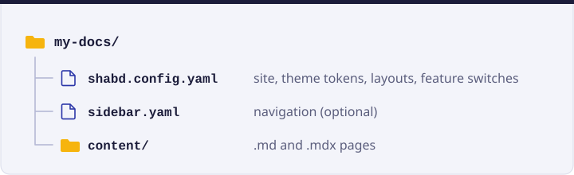

<p align="center">
  <picture>
    <source media="(prefers-color-scheme: dark)" srcset="img/shabd-logo-dark.svg"/>
    
  </picture>
</p>

<p align="center">
<strong>Documentation sites configured in YAML.</strong>
</p>

<p align="center">
  <a href="https://hi-manshu.github.io/shabd/">Documentation</a> ·
  <a href="https://www.npmjs.com/package/@himanshoe/shabd">npm</a> ·
  <a href="./ROADMAP.md">Roadmap</a>
</p>

<p align="center">
  <a href="https://www.npmjs.com/package/@himanshoe/shabd"></a>
  
  <a href="./LICENSE"></a>
</p>

Shabd (शब्द, "word") builds a documentation site from a folder of Markdown and two YAML files. The header, the
sidebar, the theme and the layout of every page are described in that YAML, not in components. A mistake in it is
reported with the file, the line and the key you probably meant.

<p align="center">
  <picture>
    <source media="(prefers-color-scheme: dark)" srcset="img/readme/structure-dark.svg"/>
    
  </picture>
</p>

A site made this way has search that runs in the reader's browser, by keyword and, if you turn it on, by meaning.
It has twenty-three themes that readers can switch between, `llms.txt` and an MCP endpoint for AI agents, an
editor on the page while you write, and code samples that run. [The documentation](https://hi-manshu.github.io/shabd/) shows each of them, and
is itself a Shabd site.

```sh
npm create @himanshoe/shabd@latest my-docs
```
