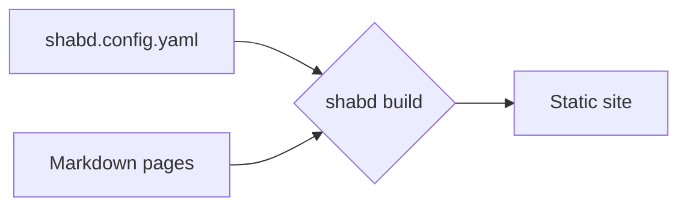

Shabd reads GitHub Flavored Markdown. Files ending in `.md` and `.mdx` go through the same pipeline; `.mdx` files can
also use components.

## Headings

Every heading gets an id made from its text, and a link that appears when you hover over it. The headings between the
levels set by `toc` appear under "On this page".

## Callouts

Write a callout as a GitHub alert. The five types are `NOTE`, `TIP`, `IMPORTANT`, `WARNING` and `CAUTION`.

```md
> [!WARNING] Back up first
> This command rewrites files in place.
```

> [!NOTE]
> A note holds information the reader should not miss.

> [!TIP]
> A tip suggests a better way to do something.

> [!IMPORTANT]
> Important callouts hold what the reader needs in order to succeed.

> [!WARNING] Back up first
> Text after the type becomes the title.

> [!CAUTION]
> A caution warns about consequences that are hard to undo.

## Code blocks

Code is highlighted when the site is built, so no highlighter is sent to the browser. Options go after the language:

````md
```ts title="src/greet.ts" {2} showLineNumbers
export function greet(name: string) {
  return `Hello, ${name}`
}
```
````

```ts title="src/greet.ts" {2} showLineNumbers
export function greet(name: string) {
  return `Hello, ${name}`
}
```

| Option | Effect |
| --- | --- |
| `title="…"` | Shows a file name above the code |
| `{2,4-6}` | Highlights those lines |
| `ins={2,4-6}`, `del={3}` | Marks those lines as added, or as removed: see [below](#lines-that-changed) |
| `showLineNumbers` | Numbers the lines |
| `wrap` | Wraps long lines instead of scrolling |
| `noLineNumbers`, `noWrap` | Turn either off for this block when [the theme](../../configuration/theme.md#code) turns it on for all |
| `noVars` | Leaves [variables](#variables) in this block as they are written |

### Lines that changed

To show a change, mark the lines that were added and the lines that were removed.

````md
```ts ins={3} del={2}
export function greet(name: string) {
  return 'Hello, ' + name
  return `Hello, ${name}`
}
```
````

```ts ins={3} del={2}
export function greet(name: string) {
  return 'Hello, ' + name
  return `Hello, ${name}`
}
```

A marked line has a bar at its edge and a plus or a minus beside it, so the mark does not depend on telling two
colours apart. Nothing is laid behind the text: the colours of code are checked for contrast against the
background they are drawn on, and a tint behind a changed line would be one they were not checked on.

## Links

Link to other pages by their file path, as you would on GitHub. Shabd rewrites the link to the page's address.

```md
[Installation](../installation.md)
```

## Variables

A value that is written on many pages, such as a version number, can be given a name in the config and used by
that name.

```yaml title="shabd.config.yaml"
vars:
  version: 2.1.0
  product:
    name: Acme
```

```md noVars
Install {{product.name}} {{version}}:

    npm install acme@{{version}}
```

A name between two pairs of braces is replaced by its value wherever it is written: in prose, in code samples and
in frontmatter, so a title or a description can use one. The value also reaches search, `llms.txt` and the Markdown
copy of the page. A value inside a group is written with a dot, as `product.name` is above. The
[installation page](../installation.md) takes the Node.js version it names from a variable.

Only names that `vars` defines are replaced. Anything else in braces is left as it is, because braces mean other
things too: a template in a code sample, an expression in MDX. A name that is nearly a variable, such as
`versoin`, is most likely a mistake, and [`shabd check`](../../reference/cli.md) reports it with its line.

To keep a code sample as it is written, add `noVars` after its language. To write the braces themselves in prose,
put a backslash before each one.

## HTML

HTML can stand among the Markdown of a `.md` page, as it can on GitHub: a key, a line break, a section that folds
away.

```md
Press <kbd>Ctrl</kbd> + <kbd>S</kbd> to save.

<details>
<summary>What is saved?</summary>

The page as it is in the editor. **Markdown** inside the block is still Markdown, as long as an empty line
separates it from the tags.

</details>
```

Press <kbd>Ctrl</kbd> + <kbd>S</kbd> to save.

<details>
<summary>What is saved?</summary>

The page as it is in the editor. **Markdown** inside the block is still Markdown, as long as an empty line
separates it from the tags.

</details>

A link or a picture written as a tag is treated like one written in Markdown: a link to another page is rewritten
to the page's address, and a heading gets its id and its place in the outline.

HTML is not [components](./components.mdx). `<Tabs>` in a `.md` page reaches the browser as an element it does not
know, and the tabs are not drawn. `shabd check` warns about a tag that is written like a component in a `.md`
page; the remedy is to name the file `.mdx`. In an `.mdx` page a tag is JSX, which is stricter than HTML: every tag
has to be closed.

## Diagrams

With `markdown.mermaid` on, a fenced block with the language `mermaid` is drawn as a diagram by
[Mermaid](https://mermaid.js.org).

````md

````


It needs one package, and the switch:

```sh
npm install mermaid
```

```yaml title="shabd.config.yaml"
markdown:
  mermaid: true
```

- A diagram is drawn in the reader's browser, not when the site is built: Mermaid has to measure text to lay a
  diagram out. The page carries the diagram's source, which is what a reader without JavaScript sees, and what
  search, `llms.txt` and the Markdown copy hold.
- It takes the colours of the site's theme, and is drawn again when the reader changes colour mode or palette.
- Mermaid is large. It is split into pieces, and only a page with a diagram fetches any. This page, with its one
  flowchart, fetched 2.3 MB more script than a page of this site without a diagram: about 660 KB once compressed.
- A diagram Mermaid cannot read is shown as its source with the message Mermaid gives. That happens in the browser,
  so `shabd check` does not catch it.

## Maths

With `markdown.math` on, text between dollar signs is typeset as maths: one pair for maths in a line of text, two
pairs for a formula on lines of its own.

````md
The roots are $x = \frac{-b \pm \sqrt{b^2 - 4ac}}{2a}$.

$$
\int_0^1 x^2 \, dx = \frac{1}{3}
$$
````

The roots are $x = \frac{-b \pm \sqrt{b^2 - 4ac}}{2a}$.

$$
\int_0^1 x^2 \, dx = \frac{1}{3}
$$

A fenced block with the language `math` is a formula too. The notation is LaTeX, typeset by
[KaTeX](https://katex.org) when the site is built. It needs two packages, and the switch:

```sh
npm install remark-math rehype-katex
```

```yaml title="shabd.config.yaml"
markdown:
  math: true
```

- A page carries the finished formula as HTML, with MathML beside it for screen readers. No script is sent to the
  browser for it. KaTeX's stylesheet joins the site's own, and its fonts are fetched by pages that use them.
- A formula that KaTeX cannot read is an error with its line, like a mistake in frontmatter.
- Once maths is on, a dollar sign that is not maths has to be written `\$`. Dollar signs in code are left alone.
- Search finds a formula by what you typed, not by how it looks.

## Tables, task lists and footnotes

| Syntax | Renders as |
| --- | --- |
| `- [x] Done` | A checked task |
| `~~text~~` | ~~Struck through~~ |
| `[^1]` | A footnote reference[^1] |

- [x] Write the page
- [ ] Publish it

[^1]: Footnotes are collected at the end of the page.
